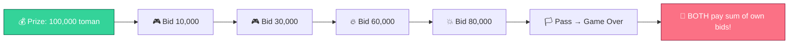

<div align="center">

# 💸 Dollar Auction — Game 2
### ✨ Cumulative All-Pay Edition ✨

> *“How far will rivalry push you past the value of the prize itself?”*

[](https://www.python.org/)
[](https://docs.python.org/3/library/tkinter.html)
[](.)
[](.)
[](.)

**🧪 Local 2-Player Pilot &nbsp;•&nbsp; 📦 Zero-Dependency CLI &nbsp;•&nbsp; 🖥️ Beautiful Tkinter GUI**

</div>

---

## 🌟 What Makes This Special?

| 🕹️ Classic Dollar Auction | 💥 **Game 2 — Cumulative Version** |
|---|---|
| Only the last bid matters | ➕ **Every bid counts — they add up!** |
| Loser pays last bid only | 💔 **Loser pays sum of ALL own bids** |
| Winner gets a bargain sometimes | ⚠️ **Even the winner can lose money!** |

<div align="center">



### 🧮 Settlement at a Glance

| Situation | 💳 Payment | 📈 Net Payoff |
|---|---|---|
| 😶 No winner | `sum of own bids` each | `0` each |
| 🏆 Winner exists | `sum of own bids` each | 🏆 `prize − winner total` <br>💔 `−loser total` |

</div>

---

<div align="center">

| File | 🎯 Role | 💡 Best For |
|------|---------|-------------|
| `⚙️ ...local.py` | 🧠 Engine + ⌨️ CLI | 🔬 Lab control, scripting, no-GUI machines |
| `🎨 ...gui.py` | 🖥️ Tkinter GUI | 👥 Running participants, live display |

</div>

---

## 📜 Game Rules — Simple, Brutal

> 1️⃣ Prize in **USD** → converted to **toman** with a fixed manual rate 💱
> 2️⃣ Opening player is **randomized** 🎲
> 3️⃣ Every bid must be **strictly higher** than the last 📈 — no cap, no fixed step!
> 4️⃣ Each turn: **💰 BID** or **🏳️ PASS**
> 5️⃣ First pass **after a valid bid** ends the game 🔚
> 6️⃣ If nobody bid yet → the other player gets an opening chance 🔄

```
🎮 Turn: Player A
💰 Prize: 100,000 toman
🔝 Highest: 30,000 toman
👤 Yours: 10,000  |  🤝 Opponent: 30,000
👉 Enter bid in TOMAN, or P to pass:
```

---

## 🚀 Quick Start

### ✅ Requirements

 

```bash
# Only needed for Excel export:
python -m pip install openpyxl
```

### 🖥️ ▶️ Run the GUI (recommended for participants)

```bash
python dollar_auction_game2_gui.py
```

<div align="center">

**⚙️ Setup → 📖 Instructions → 🎮 Play → 💾 Save Excel**

| Step | Action |
|------|--------|
| 1️⃣ | ✍️ Enter prize, rate, pseudonyms, reaction mode **A / B** |
| 2️⃣ | ✅ `VALIDATE SETTINGS → START` |
| 3️⃣ | 📖 Read instructions together → `BEGIN GAME` |
| 4️⃣ | 💰 Type `1,250,000` (auto-formatted!) or 🏳️ `PASS` |
| 5️⃣ | ➡️ `CONTINUE TO NEXT TURN` after every move |
| 6️⃣ | 💾 `SAVE ALL RESULTS TO EXCEL` → one `.xlsx` file! |

</div>

### ⌨️ ▶️ Run the Terminal version

```bash
python dollar_auction_game2_local.py
```

> 🔒 *Use pseudonyms only — never real names!*

---

## 📊 Outputs — Research-Ready Data

### 📄 CLI → `*.csv` — one row per decision

<details>
<summary>🔍 <b>Click to see all columns</b></summary>

```
🆔 session_code, stage_number, event_code, participant_id, opponent_id
🎮 action (bid/pass), new_bid_toman, opponent_previous_bid_toman, bid_increment_toman
👑 previous_leader_id, leader_after_decision_id, is_escalation, is_leader_change
💰 prize_usd, usd_to_toman_rate, prize_toman, rate_source, rate_timestamp
⏱️ event_timestamp, opponent_bid_displayed_at, response_opportunity_started_at
⚡ reaction_time_mode_a, reaction_time_mode_b, selected_mode, selected_time
🏁 winner_id, loser_id, winning_bid_toman, payment_toman, net_payoff_toman
🔗 chronological_bid_sequence
```

> 🛡️ Never overwrites: `file.csv` → `file_2.csv` → `file_3.csv` …

</details>

### 📗 GUI → `*.xlsx` — one workbook, 4 styled sheets!

| 📑 Sheet | 📝 Contains | 🎨 Style |
|----------|-------------|----------|
| **① Decision Data** | 📋 Event-level records + A/B/C | 🟩🟨🟥 row tinting |
| **② Stage Analysis** | 📈 Cumulative trajectory + prize ratio | 🟩🟨🟥 trajectory |
| **③ Participant Summary** | 👥 Totals, A/B/C counts, first B/C | 🔢 color counts |
| **④ Read Me** | 📖 Rules, legend, limits | 💡 guide |

---

## 🚦 The Famous A / B / C Zones!

> 🧠 A **post-hoc behavioral proxy** — computed AFTER the game from cumulative bids. <br>
> ❌ **Not** shown during play &nbsp;•&nbsp; ❌ **Not** a physiological arousal measure

<div align="center">

| Zone | 📐 Rule | 🎨 Color | 💭 Meaning |
|------|---------|----------|------------|
| **🟢 A — Safe** | `total < 50% × prize` |  | 😌 Still comfortable |
| **🟡 B — Heated** | `50% ≤ total ≤ 100%` |  | 😬 Getting serious… |
| **🔴 C — Overcommitted** | `total > 100%` |  | 🔥 Past the prize! Sticky-red till the end! |

**Sticky-red rule:** once anyone crosses 100%, *all later events stay red* — even the final 🏳️ pass!

```
  0% ────── 🟢 A ────── 50% ────── 🟡 B ────── 100% ────── 🔴 C ──→ ∞
  ▲                    ▲                         ▲
  start              tension                point of no return 💥
```

</div>

---

## ⚡ Reaction Time — Two Lenses

| Mode | ⏱️ Measured From | ➡️ To |
|------|------------------|-------|
| **🅰️ Mode A** | 🚦 `response_opportunity_started_at` | ✍️ response |
| **🅱️ Mode B** | 👀 `opponent_bid_displayed_at` | ✍️ response |

> 🖥️ GUI enables buttons **~1000 ms** after display → clean separation of the two clocks. <br>
> ⌨️ Invalid input restarts clocks, never counts as a decision.

---

## 🛡️ Built-in Validation ✅

```
✔ two-player roster and unique event IDs
✔ sequential stages and valid action types
✔ strictly increasing bids and bid increments
✔ leader and opponent-bid history reconstructed
✔ final bids, payments, winner & payoffs consistent
```

> ❌ If validation fails → **no file is saved as “validated”**. Debug first!

---

## 🎬 Live Example — Feel the Escalation!

```
💰 Prize: $1 × 100,000 = 100,000 toman
─────────────────────────────────────────
① 🧑 A bids 10,000  → total A = 10,000   🟢 A
② 👩 B bids 30,000  → total B = 30,000   🟢 A
③ 🧑 A bids 60,000  → total A = 70,000   🟡 B  😬
④ 👩 B bids 80,000  → total B = 110,000  🔴 C  💥
⑤ 🧑 A passes 🏳️ → 🔚 GAME OVER
─────────────────────────────────────────
🏆 Winner: B (last bid 80,000)
💳 Pay A = 70,000  |  Pay B = 110,000
📉 Payoff A = -70,000  |  Payoff B = -10,000
😱 Even the WINNER lost money — that's the Dollar Auction trap!
```

---

## ⚖️ Ethics & Research Notes

> ⚠️ **Pilot research prototype** — not yet a validated instrument!

- 🔒 Always pseudonymize — no real names
- 📋 Finalize neutral instructions + informed consent + debrief before formal use
- 💬 GUI end-screen debrief is generic — replace with your ethics-approved text
- 📝 Document version `thesis_game_2_cumulative_all_pay` + thresholds in Methods

---

<div align="center">

### 💖 Made for Lab & Thesis Pilots

⭐ *If this helped your research, star the repo!* ⭐

`v4.5` &nbsp;•&nbsp; `thesis_game_2_cumulative_all_pay` &nbsp;•&nbsp; 📧 Questions? Open an issue!

</div>
